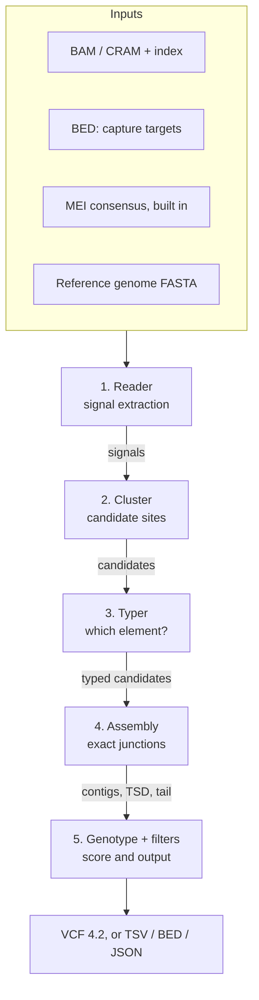
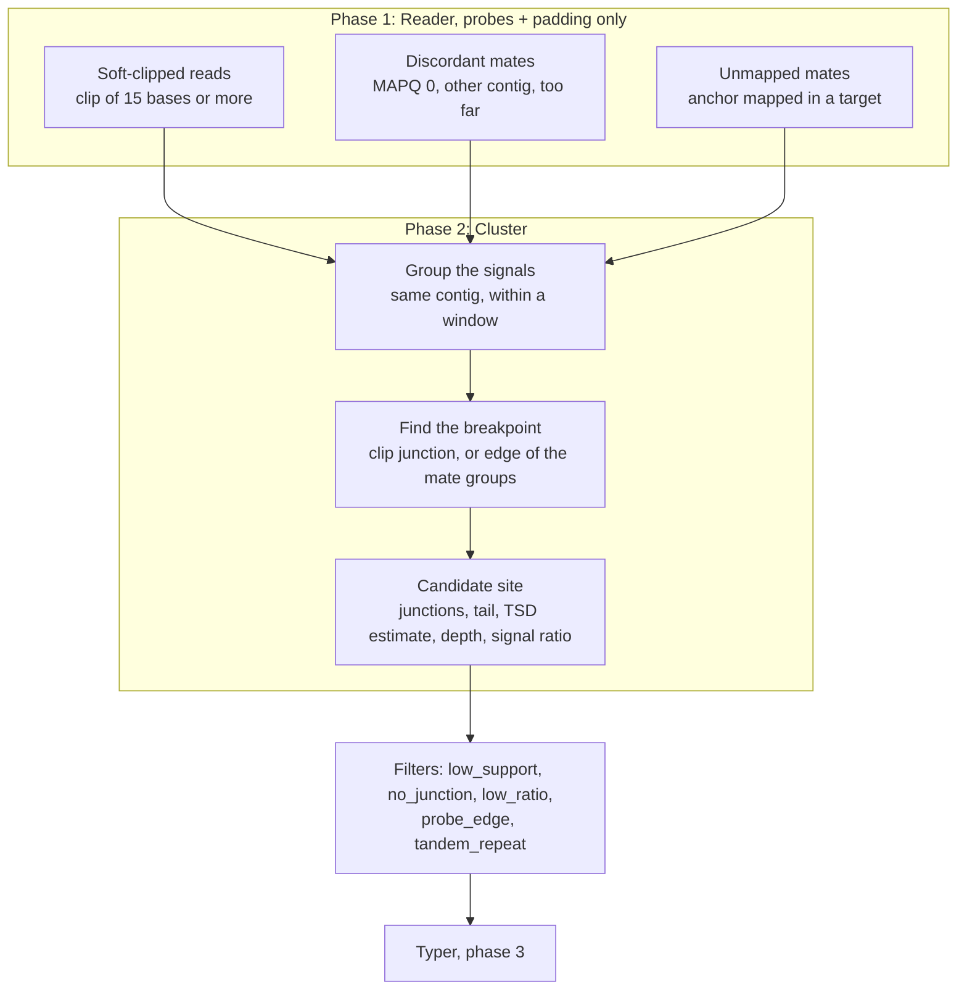
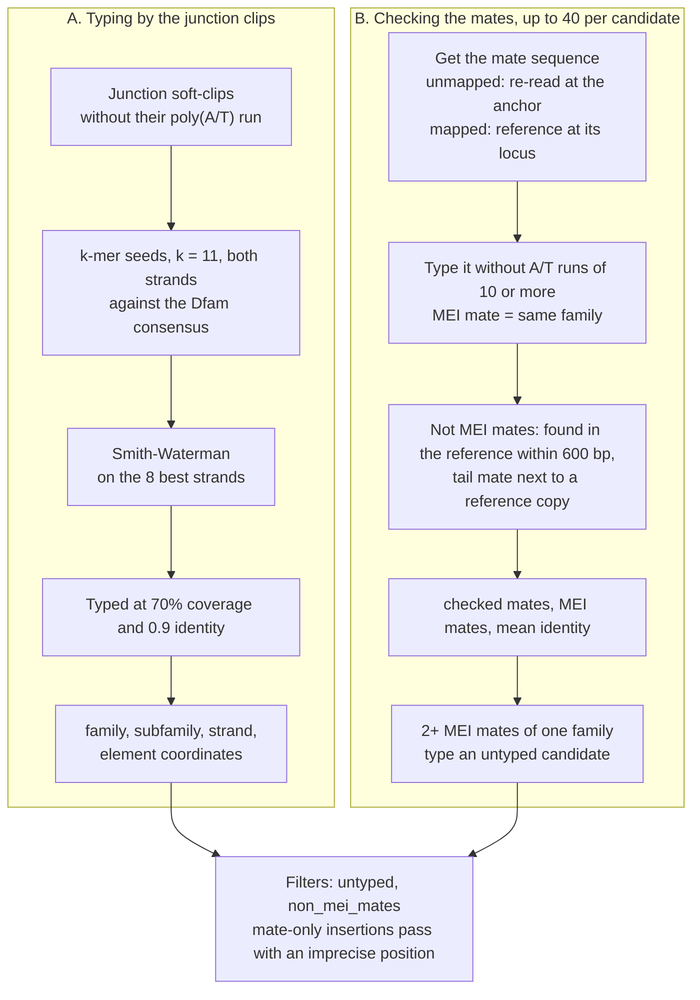
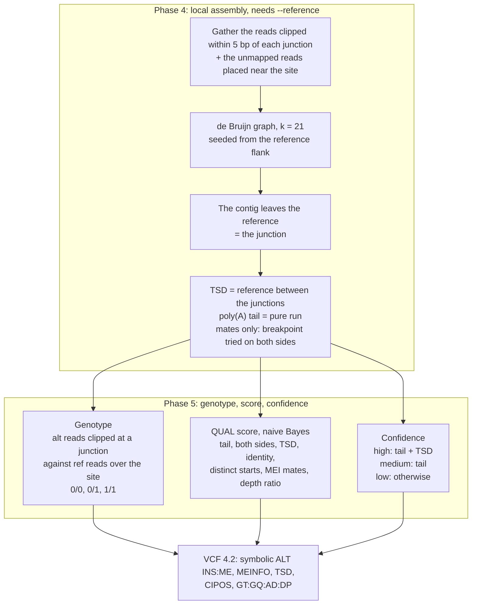

# Mei-rs

A Rust tool for detecting mobile element insertions (Alu, LINE-1, SVA) in
targeted capture and exome sequencing data. One exome takes 30 s to 4 min and
0.5 to 2.5 GB on 12 to 18 cores; against Scramble it is faster in wall time
(1 to 5 times, from using every core) but uses 1.5 to 9 times more CPU time
([measured](docs/validation/README.md#comparison-with-scramble)). It is a
research tool, not validated for clinical use (see
[Accuracy and limitations](#accuracy-and-limitations)).

Mei-rs reads only the capture targets of an indexed BAM or CRAM file, collects
the reads that betray an insertion (soft-clipped reads, discordant pairs,
unmapped mates), groups them into candidate insertion sites, types the
inserted element against Alu, LINE-1 and SVA consensus sequences, and removes
the artefacts specific to capture data, such as soft-clips that stop at the
probe edges.

> **Status: v0.4.0.** `mei-rs scan` finds candidate insertion
> sites, types the element (family, subfamily, strand), assembles the
> junctions (TSD, poly(A) tail), genotypes and scores the candidates, and
> writes TSV, BED, JSON or VCF. Precision and recall on real exomes are in
> [Accuracy and limitations](#accuracy-and-limitations).

## Installation

From a release binary (Linux x86_64 and aarch64 with glibc 2.17 or later,
macOS arm64 and x86_64), with its checksum, on the
[releases page](https://github.com/VictorYt/Mei-rs/releases):

```bash
tar xzf mei-rs-vX.Y.Z-x86_64-unknown-linux-gnu.tar.gz
sha256sum -c mei-rs-vX.Y.Z-x86_64-unknown-linux-gnu.tar.gz.sha256
mei-rs-vX.Y.Z-x86_64-unknown-linux-gnu/mei-rs --version
```

From the container image (Linux x86_64 and aarch64):

```bash
docker run --rm -v "$PWD":/data -w /data ghcr.io/victoryt/mei-rs:latest \
  scan --bam sample.bam --bed targets.bed --reference genome.fa -o sample.tsv
# or build it from a clone: docker build -t mei-rs .
```

From source, with Rust 1.91 or later:

```bash
cargo install --git https://github.com/VictorYt/Mei-rs --locked
# or, from a clone:
cargo build --release   # binary in target/release/mei-rs
```

The binary has no runtime dependency: BAM, CRAM, BED and FASTA files are read
in pure Rust.

## Usage

```bash
mei-rs scan \
  --bam sample.bam \
  --bed targets.bed \
  --reference genome.fa \
  --output sample.candidates.tsv \
  --threads 8

# CRAM: the reference is required
mei-rs scan --bam sample.cram --reference genome.fa --bed targets.bed

# VCF, bgzipped and indexed: sample.mei.vcf.gz and sample.mei.vcf.gz.tbi
mei-rs scan --bam sample.bam --bed targets.bed --reference genome.fa \
  --format vcf --output sample.mei.vcf.gz
```

The candidates are written to standard output unless `--output` is given; the
logs (inputs, read counts, insert size, signals, candidates) go to standard
error.

### Inputs

| Input | Requirements |
|---|---|
| `--bam` | BAM or CRAM, coordinate-sorted and indexed (`.bam.bai`, `.bam.csi`, `.bai`, `.cram.crai` or `.crai`). The sample name is the `SM` of the read groups, or else the file name. |
| `--bed` | capture targets: at least 3 columns (contig, 0-based start, end), tabs or spaces, plain or gzipped. `#`, `track` and `browser` lines are skipped. The contig names must match the alignment (`chr1` vs `1` is reported). |
| `--reference` | reference genome indexed with `samtools faidx` (`.fai`); required for CRAM, and recommended for BAM: without it, the `tandem_repeat` filter is off, mapped mates are not checked against the MEI consensus sequences and the junctions are not assembled (TSD estimated from the clips). When given, its contigs must match the lengths of the alignment header. |
| `--consensus` | MEI consensus sequences (FASTA, headers `>name#SINE/Alu`, `>name#LINE/L1`, `>name#Retroposon/SVA`). Default: the Alu, young LINE-1 and SVA consensus sequences of Dfam (CC0) built into mei-rs, see [data/consensus](data/consensus/README.md). |

Inconsistent inputs fail early with a message that says how to fix them.
Targets on contigs absent from the alignment, or beyond their contig, are
skipped with a warning.

### Options

| Option | Default | Meaning |
|---|---|---|
| **Input** | | |
| `--padding` | 300 | bases added on each side of every target; padded targets that overlap are merged |
| `--region` | | only scan this region (`chr`, or `chr:start-end`, 1-based inclusive) |
| **Read filtering** | | |
| `--min-mapq` | 20 | minimum mapping quality of an anchored read; mates below it are low-MAPQ mates |
| `--include-duplicates` | off | keep reads flagged as duplicates (files without duplicate marking) |
| **Signal extraction** | | |
| `--min-clip-len` | 20 | minimum length of a soft-clip |
| `--min-short-clip-len` | 15 | minimum length of a shorter soft-clip, kept only with a poly(A/T) tail or typed to an MEI consensus, and counted at the junctions only when a mate is an MEI mate (short reads often see a short piece of the junction); at or above `--min-clip-len`, short clips are not used |
| `--min-clip-quality` | 20 | minimum median base quality of a soft-clip |
| `--polya-min-len` | 10 | minimum length of a poly(A/T) tail at the junction end of a soft-clip |
| `--polya-min-frac` | 0.8 | minimum fraction of A (or T) in a tail, to tolerate sequencing errors |
| **Clustering and filters** | | |
| `--window` | 100 | maximum distance between two consecutive signals of a candidate |
| `--min-support` | 3 | minimum number of distinct supporting reads of a candidate |
| `--min-clips` | 2 | minimum number of soft-clips at the junctions (`no_junction` below); each junction needs as many to give a TSD |
| `--min-typed-clips` | 2 | minimum number of junction soft-clips typed to an MEI consensus (`untyped` below, unless one typed clip has a poly(A/T) tail and the candidate has as many MEI mates, or, typed by its mates, as many tailed clips and MEI mates of 96% identity; 0 turns the filter off) |
| `--min-mei-mate-fraction` | 0.3 | minimum fraction of MEI mates among the mates checked against the consensus sequences (`non_mei_mates` below; 0 turns the filter off) |
| `--require-tail` | off | also require a soft-clip with a poly(A/T) tail (`no_tail`) |
| `--min-signal-ratio` | 0.05 | minimum number of supporting reads per read of local depth |
| `--min-qual` | 0 | minimum quality score (`low_qual` below; 0 turns the filter off) |
| `--probe-edge-tolerance` | 2 | distance in bp to a probe start or end within which a soft-clip stops at the probe edge |
| `--keep-filtered` | off | also write the candidates flagged `no_junction`, `no_tail`, `untyped`, `non_mei_mates`, `tandem_repeat`, `probe_edge`, `low_ratio` or `low_qual` |
| **Output** | | |
| `-o`, `--output` | stdout | output file |
| `--format` | `tsv` | `tsv`, `bed`, `json` (with every signal of every candidate) or `vcf` (VCF 4.2; bgzipped and indexed, `.tbi`, when `--output` ends with `.gz`) |
| **Global** | | |
| `-t`, `--threads` | all cores | worker threads |
| `-v`, `-q` | | more (`-v`, `-vv`) or fewer (`-q`) logs; `RUST_LOG` takes precedence |

### How it works

The pipeline has five phases (below, then the detail of each step). Editable
Excalidraw sources and SVG exports of the schemes are in
[`docs/images`](docs/images).



<details>
<summary>Detailed schemes (phases 1 to 5)</summary>

Phases 1 and 2, from reads to candidate sites
([SVG](docs/images/2-signals-and-clusters.svg)):



Phase 3, typing the element
([SVG](docs/images/3-typing.svg)):



Phases 4 and 5, assembly, genotype, score and output
([SVG](docs/images/4-assembly-genotype-output.svg)):



</details>

1. **Signal extraction**, in parallel over the padded targets: reads that are
   primary, mapped, not duplicates and above `--min-mapq` can anchor a signal.
   - **Soft-clips** of at least `--min-clip-len` bases: the junction gives the
     breakpoint to the base, and a poly(A) or poly(T) tail at the junction
     gives the strand of the element. Shorter clips, down to
     `--min-short-clip-len`, are kept only with a poly(A/T) tail or when
     typed to an MEI consensus (step 3), and count at the junctions only
     when a mate is an MEI mate (step 4): with 2x75 bp reads, a read often
     holds a short piece of the junction, but alone a short clip is often a
     piece of a nearby repeat.
   - **Mate signals**: the mate is unmapped, maps with a low MAPQ, maps to
     another contig, or maps unusually far away on the same contig (beyond the
     median insert size + 6 × 1.4826 × MAD of the sample).
2. **Clustering**: signals at most `--window` bases apart form a candidate.
   Its position is the most supported junction; the junctions of the two
   flanks give the TSD. Without junction soft-clips, the mate signals place
   it (inner edge of the reads facing the insertion, within a confidence
   interval), then the interval is read again: the boundary where reads are
   soft-clipped by 3 bases or more (at least 2) becomes the position.
3. **Typing**: each junction soft-clip, without the pure run of its tail, is
   seeded against a k-mer index of the consensus sequences (both strands) and
   aligned locally (Smith-Waterman) to the best ones; a clip is typed when at
   least 70% of it aligns with 90% identity or more. The candidate takes the
   family and subfamily with the highest summed score, the strand of the
   element and the part of the consensus covered. Then up to 40 mates per
   typed candidate are checked the same way: unmapped mates by their read (placed
   at the anchor, it is read with it), mapped ones (low MAPQ, another contig,
   large insert) by the reference over their aligned part (mate CIGAR, `MC`
   tag), with `--reference`.
   Untyped candidates with a poly(A/T) tail clip, and candidates without
   junction clips but with enough mate signals for their depth, have their
   mates checked too: on short reads the clips at the tail junction are
   often the tail alone, or the junctions have no clip of 15 bases, and at
   least 2 mates of one family type the candidate (`typed_by` `mates`).
   Those without junction clips but with MEI mates are placed again among
   the reads clipped by 3 bases or more.
4. **Filters**: `no_junction` when fewer than `--min-clips` soft-clips mark
   the junctions (mate signals alone), unless young MEI mates (98% identity,
   at least 60% and 4 of the checked mates) type it and reads are clipped
   by a few bases at its position; `untyped` when fewer than
   `--min-typed-clips` of them are typed, unless one typed clip has a
   poly(A/T) tail and the candidate has as many MEI mates, or the candidate
   is typed by its mates with as many tailed clips and MEI mates of 96%
   identity or more (short clips count
   in both only when a mate is an MEI mate); `non_mei_mates` when mates were
   checked and fewer than `--min-mei-mate-fraction` of them are mobile
   elements; `no_tail` (with `--require-tail`)
   without any poly(A/T) tail;
   `tandem_repeat` (with `--reference`) when the soft-clips are the reference
   with a longer homopolymer or tandem repeat, such as the poly(A) tract of
   an Alu of the reference, rather than an insertion;
   `probe_edge` when every soft-clip stops within `--probe-edge-tolerance`
   of a probe start or end, without any poly(A/T) tail, typed clip or TSD
   (digestion or ligation artefact of the capture); `low_ratio` when the
   supporting reads are too few for the local depth; `low_qual` when the
   quality score is below `--min-qual` (off by default). The quality score
   is the phred-scaled probability that the candidate is not an insertion,
   from its evidence (tail, MEI mates, typing identity, distinct fragments,
   reads for the depth, both sides, TSD), with likelihood ratios measured on
   the HGSVC3 exomes.
5. **Assembly** (with `--reference`), for typed candidates with junction
   soft-clips: the reads clipped at each junction, and the unmapped reads
   placed near the candidate, are assembled from the reference flank into
   the element (de Bruijn graph, k = 21; a homopolymer longer than k, such
   as a long poly(A) tail, is measured on the reads that hold it whole).
   Where the contig leaves the reference is the exact junction; with both
   junctions, the reference between them is the TSD (none when the flanks
   do not overlap), and the run of A (or T) next to a junction is the
   poly(A) tail. The assembled junctions and TSD replace the estimates from
   the clips; when a junction is not assembled, the estimate stays.
6. **Genotype** of the written candidates: at each junction, reads clipped
   there (alternative allele) against reads aligned over the whole site
   (reference allele), each with at least `--min-short-clip-len` bases on
   both sides of the junction; the most likely of `0/0`, `0/1` and `1/1`
   (30% of alternative reads expected for `0/1`: they are under-counted),
   with its quality.
7. **Confidence** of the `PASS` candidates: `high` with a poly(A/T) tail and a
   TSD (complete evidence of a retrotransposition), `medium` with a tail,
   `low` without a tail (typed clips only), or when typed by its mates only.

### Output

One line per candidate, sorted by position. Positions are 1-based: a position
`p` means the insertion is right after base `p`. Example:

```
#id    contig  position  left_junction  right_junction  tsd_length  strand  filter  confidence  support  ...
MEI_1  chr1    10012     10012          10000           12          +       PASS    high        160      ...
```

Every column of the TSV, BED and JSON formats is described in
[docs/output.md](docs/output.md).

## Accuracy and limitations

Measured against the HGSVC3 MEI calls (long-read assemblies) on seven 1000
Genomes exomes and on HG002 (held out), with the method and commands in
[docs/validation](docs/validation/README.md) (#26):

| | Precision | Recall (`PASS`) |
|---|---|---|
| Seven 1000 Genomes exomes, 371 MEIs | 0.759 (0.717 to 0.799) | 0.337 (0.256 to 0.423) |
| Same, `--min-qual 5` | 0.950 | 0.305 |
| HG002 (GRCh37), 49 MEIs | 0.415 | 0.347 |
| MELT 2.2.2, seven exomes | 0.897 | 0.259 |
| Scramble 1.0.2, seven exomes | 0.687 | 0.154 |
| xTea 0.1.9, seven exomes (default / exome cutoffs) | 0.852 / 0.767 | 0.062 / 0.089 |

The intervals in brackets are 95% bootstrap intervals over the seven samples.
On the same seven exomes Mei-rs finds more of the insertions than MELT,
Scramble and xTea (recall 0.337 against 0.259, 0.154 and at most 0.089) and is
less precise than MELT (0.759 against 0.897). Its precision on HG002, held out
(0.415), is far below that on the seven exomes: the quality score and several
thresholds were fitted on those seven exomes ([thresholds](docs/thresholds.md)),
so their numbers are optimistic for a new sample. The comparison with MELT,
Scramble and xTea is in [docs/validation](docs/validation/README.md#comparison-with-melt-and-xtea).

### Which `--min-qual`

The threshold trades recall for precision; the default (0) keeps every `PASS`
call. Measured on the seven exomes (HG002 in brackets):

| Use | `--min-qual` | Precision | Recall (`PASS`) |
|---|---|---|---|
| Discovery, nothing missed, confirm afterwards | 0 (default) | 0.759 (0.415) | 0.337 (0.347) |
| Screening, little cost in recall | 2 | 0.893 (0.567) | 0.334 (0.347) |
| Short list to confirm | 5 | 0.950 (0.577) | 0.305 (0.306) |
| Very short list | 10 | 0.968 | 0.245 |

The quality score ranks the calls better than it estimates a probability (AUC
0.928 leaving one sample out, 0.787 on HG002). Whatever the threshold,
insertions close to a reference copy of the same family and very deep samples
produce false calls (the `low` confidence tier).

Recall counts every MEI within 300 bp of a target: 27 of the 36 MEIs inside
the targets are called `PASS`, against 36 of the 240 at 101-300 bp from them.
`high` and `medium` candidates (with a tail) are the most reliable (48 true of
52); most false positives are `low` (no tail): use `--min-qual` (0 by default)
to trade recall for precision.

Other limitations:

- Typing uses the junction soft-clips (15 bases or more without their tail),
  not the assembled contigs. Close subfamilies (e.g. AluY and AluYa5) are
  often not told apart; LINE-1 typed by the ORF2 model (#56) are reported as
  `L1P1_orf2`, with coordinates in that model.
- Candidates without junction clips are placed and typed by their mates
  (#57-#59, #70): the position is imprecise (`CIPOS`) unless the junction is
  assembled (#66, 2 of 13 on the HGSVC3 exomes: short exome clips rarely
  extend a contig), and a truth MEI whose mates are only poly(A) tail stays
  missed.
- Assembly needs `--reference`, and few exome candidates have both junctions
  assembled; otherwise the TSD comes from the soft-clip junctions.
- The genotype under-counts insertion reads (clips of 15 good bases): it
  assumes 30% of them at a heterozygous site; 91 of 123 true calls are right.
- Candidates closer than `--window` are merged into one.
- On older data, most soft-clips fall below `--min-clip-quality` (read ends
  masked by the base caller); the log reports how many are set aside (#25).
- CRAM is slower than BAM: decoding its blocks costs more than reading BAM
  (NA12878 on 12 cores, same output: BAM 66 s and 1.2 GB, CRAM 124 s). On
  macOS, the allocator keeps the freed reference sequences in memory.

### Scope and licence

Mei-rs is a research tool. It has not been validated for clinical use: it was
evaluated on 7 exomes of one resource (plus HG002), with long-read assembly
calls as truth, and no panel data. Confirm its calls with an orthogonal
method before any clinical use.

Mei-rs is licensed under the AGPL-3.0-or-later. Running the binary on your
data, inside a pipeline or a workflow engine, does not subject the rest of the
pipeline to the licence. Modifying Mei-rs and offering the result to users over
a network (a hosted service) requires offering them the modified source, and a
program that embeds its code is a derivative work under the licence. This is
a summary, not legal advice: ask your legal department before integrating it
in a product.

All the thresholds of the pipeline, with how each was set, are listed in
[docs/thresholds.md](docs/thresholds.md).

## Development

```bash
cargo build --release
cargo test                  # unit, property and end-to-end tests on synthetic fixtures
cargo bench                 # criterion benchmarks (extraction, clustering, typing)
fuzz/run.sh 30              # cargo-fuzz targets, 30 s each (nightly toolchain, cargo-fuzz)
tests/data/generate.sh      # regenerate the fixtures (python3, samtools, perl)
UPDATE_EXPECTED=1 cargo test --test scan   # update the expected outputs
```

See [CHANGELOG.md](CHANGELOG.md) for the release history.

## License

[GNU Affero General Public License v3.0](LICENSE) or later.
